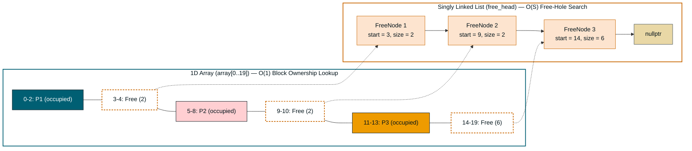
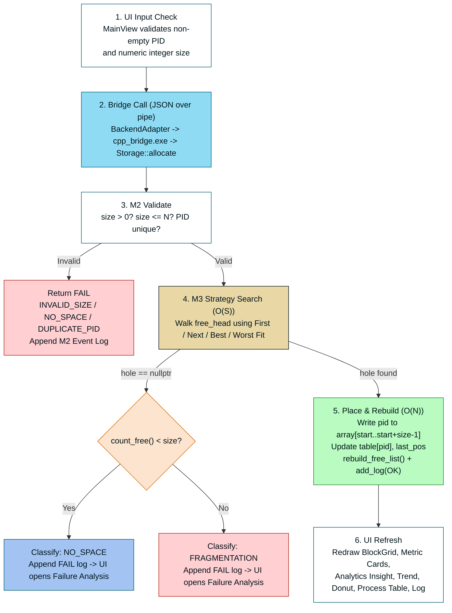

# Architecture Audit, Interface Mapping & Light-Theme Diagrams — Project 10

## 1. Stage 1 Interface Audit & Mapping Table

Every frontend data need maps strictly to M1–M4's C++ `Storage` contract via `backend_adapter.py` and `cpp_bridge.exe`.

| UI Need | Frontend Call (`backend_adapter.py`) | C++ Backend Target (M1–M4) | Return Type |
|---|---|---|---|
| Initialise storage | `BackendAdapter(total_blocks)` | `Storage::Storage(int total_blocks)` (M1) | `BackendAdapter` |
| Read block array | `backend.array` | `Storage::array` (`vector<string>`) (M1) | `list[str]` |
| Read process table | `backend.table` | `Storage::table` (`map<string, pair<int,int>>`) (M2) | `dict[str, (int, int)]` |
| Live statistics | `backend.stats()` | `Storage::stats()` (`Stats`) (M1) | `BackendStats` |
| Free segments | `backend.free_segments()` | `Storage::free_segments()` (M1) | `list[(int, int)]` |
| Allocate blocks | `backend.allocate(pid, size, strategy)` | `Storage::allocate(pid, size, strategy)` (M2 + M3) | `AllocResult` |
| Release process | `backend.release(pid)` | `Storage::release(pid)` (M2) | `ReleaseResult` |
| Event log read | `backend.get_log()` | `Storage::log` (`vector<LogEntry>`) (M2) | `list[LogEntry]` |
| Event log export | `backend.export_log_csv(filename)` | `Storage::export_log_csv(filename)` (M2) | `bool` |
| Strategy lookup | (called inside `Storage::allocate`) | `find_hole(...)` in `m3_strategies.h` (M3) | `FreeNode*` |
| Seeded workload | `backend.generate_workload(n, ops, seed)` | `generate_workload(n, ops, seed)` (M3) | `list[(op, pid, size)]` |
| Experiment suite | `backend.run_experiment(n, ops, seed, strat)` | M3 `generate_workload` + `alloc_with_strategy` + `stats` | `dict` |
| Failure classifier | `backend.analyze_failure(request_size)` | `Storage::analyze_failure(request_size)` (M4) | `FailureAnalysis` |
| Defragmentation | `backend.compact()` | `Storage::compact()` (M4) | `CompactionReport` |
| Auto-retry | `backend.allocate_with_compaction(pid, sz, st)` | `Storage::allocate_with_compaction(...)` (M4) | `AllocResult` |

---

## 2. Contract vs. Code Mismatch Log (M1–M4 Untouched)

Per M5 boundaries, M1–M4 files were **never edited**. All mismatches between the blueprint prototype specification and actual M1–M4 C++ code are bridged cleanly in `cpp_bridge.cpp` and `backend_adapter.py`:

| # | Owner | Blueprint Contract | Actual M1–M4 C++ Implementation | Resolution in Bridge |
|---|---|---|---|---|
| 1 | M1 | `stats()` returns Python `dict` | Returns C++ `Stats` struct with 7 fields (`free`, `occupied`, `segments`, `largest`, `ext_frag`, `utilisation`, `avg_hole`) | `cpp_bridge.cpp` serialises all 7 fields as JSON; `backend_adapter.py` exposes `BackendStats` attributes |
| 2 | M1 | `Storage(n)` array of zeros | `vector<string> array(n, "")` (`""` = free, PID string = occupied) | UI & bridge treat `""` as free block and non-empty string as PID |
| 3 | M1/M5 | Main screen starts on sample snapshot (100 blocks, 7 free, 4 segments) | `Storage(100)` starts empty (`free=100, occupied=0`) | `BackendAdapter(100)` replays real C++ `allocate`/`release` calls to build the 7-process sample state inside C++ (`is_sample=True` until first live user action) |
| 4 | M2 | `validate()` rejects empty PID | `Storage::validate(pid, size)` checks `size <= 0`, `size > n`, and `table.count(pid) > 0`; does not reject empty `pid` | `MainView` checks empty PID and non-numeric size before calling backend |
| 5 | M3 | `find_hole` takes `"first"`..`"worst"` | `m2_engine.cpp` normalises UI names (`"First Fit"` → `"first"`), whereas `m3_strategies.h`'s `find_hole` requires lowercase short keys | `cpp_bridge.cpp` calls `normalize_strategy()` before `find_hole` in experiments |
| 6 | M3 | C++ experiments standalone (`m3_experiments.cpp`) | `m3_experiments.cpp` has its own `main()` and writes `m3_results.csv` rather than a callable library | `cpp_bridge.cpp` exposes `workload` and `experiment` JSON commands calling M3's exact `m3_strategies.h` functions |
| 7 | M4/M1 | Frag history timeline for UI trend card | `Storage` holds current snapshot only, not historical `ext_frag` series | `BackendAdapter` appends `stats().ext_frag` after each operation; `run_experiment` records full `frag_history` per op |
| 8 | M5/M1–M4 | Cross-language invocation | Backend is compiled C++17; UI is Python/Tkinter | Persistent `cpp_bridge.exe` subprocess with single-line JSON stdin/stdout protocol |

---

## 3. Diagrams (Blueprint Figs 1 & 2, Light Theme)

### Figure 1 — Array (Ownership) and Linked List (Free Holes) Describe the Same Storage

Light-theme styling: `#FBF8CC` cream backdrop, `#FFFFFF` free cells with `#CA6702` amber border, process cells using `#005F73` / `#FFCFD2` / `#EE9B00`.

### Figure 2 — Linear Flow of One Allocation Request

